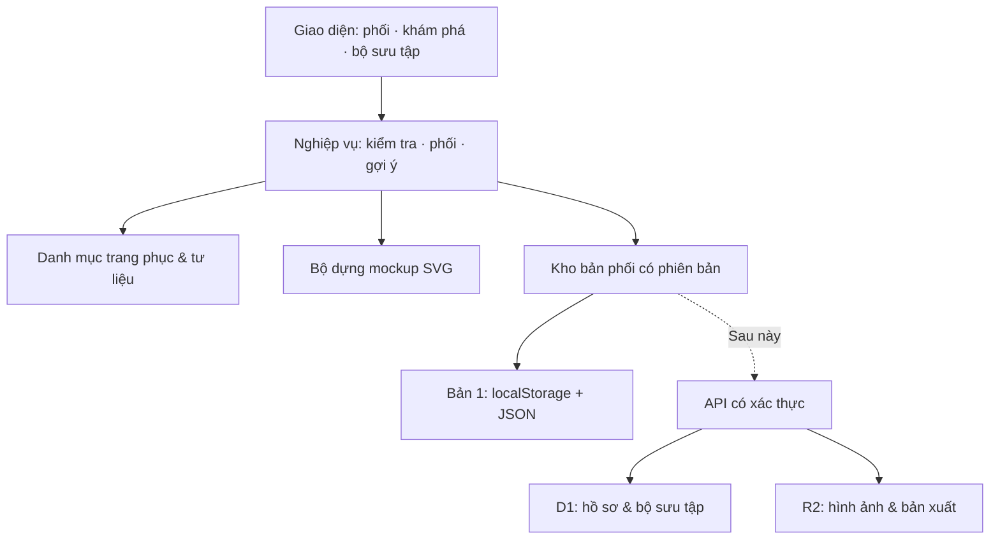

# NẾP VIỆT — KIẾN TRÚC SẢN PHẨM & HỆ THỐNG

Phiên bản tài liệu: 1.0 · Ngày: 08/10/2026 · Sản phẩm: Việt phục Remix.

## 1. Mục tiêu và phạm vi

Nếp Việt giúp học sinh, sinh viên khám phá trang phục truyền thống của người Việt, thử phối màu và phụ kiện theo dịp, rồi lưu hoặc chia sẻ ý tưởng. Mục tiêu của bản đầu là hoàn thành một hành trình sử dụng thực sự: chọn → phối → xem → hiểu → lưu. Sản phẩm không tự nhận là công cụ phục dựng cổ phục hay dịch vụ thử đồ chính xác trên cơ thể.

Phạm vi tuyển chọn ban đầu gồm áo dài, áo tứ thân và áo ngũ thân tay chẽn. Đây là ba nhóm minh họa, không đại diện toàn bộ trang phục của các cộng đồng tại Việt Nam. Địa phương là bối cảnh tìm hiểu, không phải ranh giới độc quyền của một trang phục. Những kiểu dáng có tính nghi lễ hoặc quy chế lịch sử riêng sẽ được bổ sung sau khi có tư liệu và người thẩm định.

| Người dùng | Nhu cầu | Cách bản đầu đáp ứng |
|---|---|---|
| Người mới tìm hiểu | Biết chọn gì, mặc khi nào | Thẻ nhận diện, dịp sử dụng, nguồn đọc thêm |
| Học sinh, sinh viên | Chuẩn bị chụp kỷ yếu, sự kiện trường | Mẫu gợi ý, phối nhanh, lưu nhiều phương án |
| Người thích thời trang | Thử gu riêng mà hiểu bối cảnh văn hóa | Ba phong cách, phối màu trực tiếp, nhắc cách tân |
| Người làm nội dung (tương lai) | Quản lý tư liệu có nguồn | Quy trình biên tập, phiên bản và phê duyệt |

## 2. Các quyết định kiến trúc

**Bản 1: ứng dụng web tĩnh, mô-đun JavaScript, dữ liệu tại trình duyệt.** Chưa cần backend cho hành trình phối đồ cá nhân. SVG cho phép đổi màu và phụ kiện tức thì, hoạt động không phụ thuộc mô hình AI hay khóa API, xuất được ảnh vector. Các mô-đun nghiệp vụ tách khỏi giao diện để có thể tái sử dụng khi nâng cấp.

**Giai đoạn có tài khoản: một backend chia mô-đun.** Dùng giao diện React/TypeScript khi số màn hình và tương tác cần đến; API trên Cloudflare Workers; D1 cho dữ liệu quan hệ; R2 cho ảnh và bản xuất. Chưa chia microservice. Chỉ tách xử lý ảnh sang dịch vụ GPU và hàng đợi khi triển khai thử đồ bằng ảnh vì tác vụ đó không phù hợp với tài nguyên Worker.

**Gợi ý có giải thích.** Bản đầu dùng quy tắc được viết rõ, không gắn nhãn AI và không chấm điểm “đúng văn hóa”. Gợi ý thẩm mỹ là đề xuất thiết kế; thông tin lịch sử có nguồn riêng. Màu trang phục không được dùng để suy diễn tính cách, đạo đức hoặc giá trị con người.

**Chỉ lưu khi có chủ ý.** Bản phối nháp và bộ sưu tập ở thiết bị hiện tại; sao lưu JSON và xuất SVG để người dùng tự giữ. Chưa có đồng bộ đa thiết bị. Liên kết chia sẻ chứa các lựa chọn của bản phối trong fragment URL, không chứa tên bộ sưu tập hay dữ liệu nhận dạng.

## 3. Kiến trúc logic và luồng dữ liệu



1. Khi mở trang, đọc fragment được kiểm tra theo danh sách giá trị hợp lệ; nếu không có, đọc nháp; nếu dữ liệu hỏng, khôi phục trạng thái mặc định và báo rõ.
2. Mỗi thao tác cập nhật trạng thái chuẩn hóa → tính gợi ý và nhắc văn hóa → dựng lại SVG và phần thông tin liên quan → ghi nháp.
3. Khi lưu, tạo bản chụp cấu hình, tên và thời gian; thông báo thành công chỉ sau khi ghi dữ liệu thành công. Không ghi đè bản đã lưu khi sửa bản nháp.
4. Khi so sánh, đọc hai bản chụp; hiển thị cùng một cấu trúc thông tin để so sánh trang phục, màu, phong cách, dịp, phụ kiện và lưu ý.
5. Khi xuất, SVG chứa toàn bộ minh họa; JSON dùng cấu trúc có phiên bản để có thể phục hồi. Khi nhập, kiểm tra kích thước, kiểu dữ liệu, giá trị và giới hạn số bản phối trước khi hợp nhất.

## 4. Kiến trúc trải nghiệm

| Không gian | Thành phần | Hành động chính |
|---|---|---|
| Phòng phối đồ | Chọn áo, dịp, phong cách, màu, phụ kiện; mockup; chuyện tà áo | Phối trực tiếp; nhận gợi ý; đặt lại; lưu; xuất; sao chép liên kết |
| Khám phá Việt phục | Bộ lọc vùng bối cảnh; ba thẻ trang phục; tư liệu | Đọc đặc điểm; mở nguồn; dùng trang phục đó |
| Bộ sưu tập | Các bản đã lưu; lựa chọn so sánh; sao lưu | Mở để sửa; đổi tên; xóa; so sánh hai bản; xuất/nhập JSON |
| Tài liệu dự án | Kiến trúc, phạm vi, lộ trình, nguồn | Đọc trực tiếp; tải Markdown; in thành PDF từ trình duyệt |

Luồng ưu tiên: người mới chọn một mẫu gợi ý hoặc một dịp → điều chỉnh màu/phụ kiện → thấy kết quả ngay → đọc lời giải thích → lưu. Không bắt đăng nhập, nhập thông tin cá nhân hoặc đi qua onboarding dài trước khi thử.

Thiết kế: giấy ngà `#F7F3EA`, đỏ gạch `#963F32`, mực nâu `#302D26`, xanh rêu `#59644C`, vàng đất `#BA914A`. Chữ tiêu đề có chân và chữ chức năng không chân. Khung minh họa lấy cảm hứng sân nhà, mái ngói và cành lá; tránh gán họa tiết cung đình cụ thể khi chưa có tư liệu. Hình minh họa là nét vector đương đại, có nhãn “mockup minh họa”.

Máy tính dùng bố cục ba vùng: điều khiển, kết quả, giải thích. Máy tính bảng dùng hai cột; điện thoại đưa hình kết quả lên trước và nhóm điều khiển xuống dưới. Nút có nhãn, trạng thái chọn không chỉ dựa vào màu, dùng bàn phím được, dialog giữ tiêu điểm và đóng bằng Escape; tôn trọng reduced motion.

## 5. Ranh giới mô-đun bản 1

| Tệp | Trách nhiệm |
|---|---|
| `dist/catalog.mjs` | Danh mục áo, màu, dịp, phụ kiện, phong cách, nguồn và mẫu gợi ý |
| `dist/domain.mjs` | Trạng thái mặc định; chuẩn hóa; gợi ý; cảnh báo; mã hóa liên kết; kiểm tra nhập |
| `dist/render.mjs` | Vẽ người mẫu, cấu trúc trang phục, phụ kiện, bối cảnh; xuất SVG độc lập |
| `dist/storage.mjs` | Repository cho nháp và bộ sưu tập; không phụ thuộc DOM |
| `dist/app.mjs` | Điều phối sự kiện, render giao diện, dialog, tải tệp, thông báo |
| `dist/styles.css` | Token thiết kế, layout, component, breakpoint, trạng thái truy cập |
| `tests/` | Kiểm thử nghiệp vụ, dữ liệu bất thường, lưu trữ và liên kết |

Giao diện chỉ thao tác với trạng thái hợp lệ. SVG chỉ nhận các ID đã chuẩn hóa; không nhúng SVG hay HTML người dùng tải lên. Tên bản phối được escape trước khi đưa vào HTML. Việc bổ sung trang phục cần đồng thời có metadata, renderer và tư liệu; không chỉ thêm một thẻ hình.

## 6. Mô hình dữ liệu

### Bản 1 đã triển khai

```text
OutfitConfig
  garment: ao-dai | tu-than | ngu-than
  occasion: tet | ky-yeu | le-hoi | dao-pho | di-san
  style: thanh-lich | truyen-thong | pha-cach
  color: do-gach | xanh-reu | vang-mo | hong-sen | xanh-cham | trang-nga
  bottom: trang-nga | nau-dat | den-muc
  accessories: tập ID trong [non-la, khan-van, quat, tui-may]
  avatar: toc-dai | toc-ngan
  backdrop: san-dinh | giay-ngua

SavedLook
  id: UUID, name: chuỗi ≤ 60 ký tự, createdAt: ISO-8601
  config: OutfitConfig

LookbookBackup
  app: nep-viet, version: 1, exportedAt: ISO-8601, looks: SavedLook[]
```

Giới hạn bản đầu: 50 bản phối mỗi trình duyệt; tệp nhập tối đa 1 MB và tối đa 50 bản; nhập thêm không xóa các bản đang có. Các ID, thời gian và cấu hình không hợp lệ bị từ chối. Dữ liệu lỗi không được âm thầm thay bằng trạng thái khác rồi lưu.

### Lược đồ đích khi có backend (chưa triển khai)

| Bảng | Trường và ràng buộc chính |
|---|---|
| users | id PK, auth_subject UNIQUE, display_name, created_at, deleted_at |
| garments | id PK, slug UNIQUE, title, category, description, version, publication_status |
| garment_regions | garment_id FK, region_id FK; khóa ghép; liên kết nhiều-nhiều |
| garment_variants | id PK, garment_id FK, silhouette, asset_key, period_note, version |
| sources | id PK, title, publisher, url, accessed_at, source_type, rights_note |
| cultural_claims | id PK, garment_id FK, text, source_id FK, confidence_note, revision |
| reviews | id PK, claim_id FK, reviewer_id FK, decision, note, reviewed_at |
| outfits | id PK, owner_id FK, name, config_json, schema_version, revision, timestamps |
| lookbooks | id PK, owner_id FK, name, visibility; mặc định private |
| lookbook_items | lookbook_id FK, outfit_id FK, sort_order; khóa ghép |
| media_assets | id PK, owner_id FK, r2_key UNIQUE, mime, size, purpose, delete_after |
| share_links | id PK, outfit_id FK, token_hash UNIQUE, expires_at, revoked_at |
| content_reports | id PK, target_id, category, message, status, created_at |
| audit_events | id PK, actor_id, action, entity_id, revision, created_at |

Chỉ mục ưu tiên: outfits(owner_id, updated_at), garments(publication_status, category), reviews(claim_id, reviewed_at), lookbook_items(lookbook_id, sort_order). JSON phù hợp cấu hình hình ảnh thay đổi theo phiên bản; các quan hệ sở hữu, nguồn và kiểm duyệt vẫn được chuẩn hóa. Bật khóa ngoại, migration có phiên bản, dùng revision để chống mất cập nhật.

## 7. API đích (chưa triển khai)

| Phương thức & đường dẫn | Hành vi |
|---|---|
| GET /api/v1/garments?region=&occasion=&cursor= | Danh mục công bố, phân trang, ETag |
| GET /api/v1/garments/:id | Chi tiết, nguồn và phiên bản nội dung |
| POST /api/v1/recommendations | Nhận điều kiện, trả cấu hình cùng các lý do |
| GET/POST /api/v1/outfits | Danh sách của chính người dùng / tạo bản mới |
| PATCH /api/v1/outfits/:id | Sửa với If-Match revision; trả 409 khi xung đột |
| DELETE /api/v1/outfits/:id | Xóa bản thuộc chủ sở hữu |
| POST /api/v1/outfits/:id/shares | Tạo liên kết có thể thu hồi, có hạn nếu chọn |
| DELETE /api/v1/shares/:id | Thu hồi quyền xem |
| POST /api/v1/reports | Báo lỗi văn hóa hoặc nội dung |
| POST /api/v1/admin/claims/:id/reviews | Biên tập viên phê duyệt hoặc yêu cầu sửa |

Các endpoint trả mã lỗi ổn định cùng thông báo tiếng Việt, request_id và trường lỗi cụ thể. Server kiểm tra lại toàn bộ dữ liệu, xác thực và quyền sở hữu; không tin owner_id gửi từ client. Áp dụng rate limit cho ghi, chia sẻ và tác vụ tốn tài nguyên. Client hủy request cũ khi đổi bộ lọc, hiển thị loading/empty/error riêng.

## 8. Bộ gợi ý và kiểm tra văn hóa

Bản đầu chọn mẫu nền theo dịp; giữ loại áo người dùng đã chọn; áp dụng bảng màu, phong cách và phụ kiện có lý do. Kiểm tra hòa sắc chỉ đưa mô tả như tương phản với quần sáng hoặc tổng thể trầm; không đưa điểm số khoa học giả. Các quy tắc là hàm thuần, có ID ổn định và có thể kiểm thử.

Ví dụ: phong cách phá cách với áo ngũ thân cần được gọi là bản phối đương đại; thẻ thông tin nhắc cấu trúc gốc không đồng nhất với mọi áo cách tân. Bối cảnh di sản hoặc lễ hội nhắc kiểm tra yêu cầu của nơi tổ chức. Nón và khăn vấn là hai lựa chọn đội đầu loại trừ lẫn nhau trong mockup hiện tại; chọn một sẽ thay cái kia. Hai phụ kiện cầm tay cũng được giới hạn một để tránh chồng hình vô nghĩa.

Khi mở rộng, tách luật thành eligibility (hạn chế có căn cứ), context (dịp và địa phương), visual (màu/phụ kiện), explanation (lý do và nguồn). Mọi luật có version, phạm vi, mức độ và người duyệt. Không suy diễn từ giới tính, ngoại hình hay dân tộc của người dùng. Xung đột văn hóa tạo thông tin ngữ cảnh, không áp đặt nhận định đạo đức.

## 9. Quản trị nội dung và nguồn

Luồng dự kiến: **nháp → gắn nguồn → kiểm tra nội dung → thẩm định chuyên môn → công bố → theo dõi phản hồi → sửa phiên bản**. Mỗi nhận định cần biết nguồn nào hỗ trợ, biến thể trang phục nào và thời kỳ nào. Những điểm còn tranh luận phải diễn đạt là một cách lý giải hoặc tạm không công bố.

Bản đầu tổng hợp ngắn để trải nghiệm, đã tra cứu nguồn nhưng **chưa được chuyên gia cổ phục thẩm định**. SVG là mockup giản lược, không phải rập may hay bản phục dựng. Không dùng hình ảnh từ các nguồn bên ngoài; hình vector do dự án tạo. Tư liệu tham khảo không đồng nghĩa được phép sao chép hình ảnh trong tư liệu đó.

| Chủ đề | Nguồn tham khảo được tra cứu ngày 08/10/2026 | Phạm vi sử dụng |
|---|---|---|
| Áo dài | [Vietnam Tourism — Tất cả về áo dài](https://vietnam.travel/vi/things-to-do/all-about-ao-dai-vietnams-national-dress) | Quá trình biến đổi, hình thức và dịp mặc; không khẳng định một quy định đồng phục áp dụng cho mọi trường |
| Áo ngũ thân | [Visit Hue — Tinh tế áo dài ngũ thân](https://visithue.vn/Tinh-te-ao-dai-ngu-than.html/?pid=MjA1MjR8Y3NkbGRs0) | Năm thân, cổ đứng, hàng khuy và sự đa dạng; cần kiểm chứng thêm khi phục dựng |
| Áo tứ thân | [Wikipedia tiếng Việt — Áo tứ thân](https://vi.wikipedia.org/wiki/%C3%81o_t%E1%BB%A9_th%C3%A2n) | Nguồn tổng quan thứ cấp; nhận diện lớp áo/yếm/váy; ưu tiên thay bằng tư liệu bảo tàng ở vòng thẩm định |

Không chốt niên đại khởi nguồn áo tứ thân hoặc ý nghĩa biểu tượng tuyệt đối khi chưa đủ căn cứ. Mở rộng tới trang phục các cộng đồng khác phải phối hợp người am hiểu của chính cộng đồng, xin phép dùng hình và ghi rõ bối cảnh.

## 10. Dữ liệu cá nhân và độ tin cậy

Bản 1 không thu ảnh, email, vị trí, số đo; không có analytics, quảng cáo, trình theo dõi hoặc API bên ngoài. Dữ liệu lưu ở thiết bị có thể mất khi xóa dữ liệu trình duyệt; giao diện cung cấp sao lưu. Bản phối chia sẻ hiện tại là dữ liệu nhúng trong liên kết và không thể thu hồi các bản sao đã được gửi. Site đang ở chế độ riêng tư nên liên kết không tự cấp quyền truy cập cho người khác.

Đầu vào URL, JSON và localStorage đều coi là không tin cậy: kiểm tra ID, giới hạn dung lượng, loại khóa lạ, escape tên. Không dùng eval. Các link nguồn dùng HTTPS và rel=noopener noreferrer. Khi ghi bị chặn hoặc hết quota, thông báo rõ và không báo lưu thành công. Khi xóa một bản, yêu cầu xác nhận trong UI.

Nếu thêm ảnh thử đồ: chỉ tải sau hành động rõ ràng của người dùng, nêu mục đích và hạn lưu, có nút xóa, URL ký ngắn hạn, kiểm tra định dạng và kích thước, loại metadata; không suy luận đặc điểm nhạy cảm. Quy trình dành cho người chưa thành niên và yêu cầu pháp lý phải được rà soát trước khi phát hành tính năng đó.

## 11. Hiệu năng, kiểm thử và vận hành

Bản 1 không cần tải framework hay font từ CDN. Các thao tác phối đồ chạy cục bộ. Mục tiêu thiết kế: giao diện phản hồi dưới 100 ms trên thiết bị phổ thông, CLS dưới 0,1; đây là mục tiêu, chưa phải số đo. Giữ SVG nhẹ, không render toàn bộ bộ sưu tập nếu mở rộng tới hàng nghìn bản.

Kiểm thử cần thiết: chuẩn hóa dữ liệu, xung đột phụ kiện, liên kết chia sẻ khứ hồi, JSON nhập sai phiên bản, ID độc hại, giữ đúng cấu hình khi lưu/mở, lỗi quota, giới hạn số bản. Kiểm tra tính toàn vẹn nguồn tệp và các entrypoint. Browser QA nên kiểm tra 360/768/1440 px, bàn phím, dialog, đổi áo/màu, tải tệp và localStorage sau tải lại. Nếu môi trường không hỗ trợ browser QA thì ghi rõ giới hạn, không xem unit test là bằng chứng đã kiểm tra hiển thị.

Triển khai bằng version source đã commit và đẩy vào repository, đóng gói đúng thư mục dist rồi phát hành riêng tư. Mỗi phiên bản cần biết source commit và trạng thái deployment. Rollback dùng lại phiên bản tốt đã lưu. Khi có backend: log có request_id và không chứa ảnh/token, metric tỷ lệ lỗi và thời gian gợi ý, cảnh báo lỗi ghi dữ liệu, backup định kỳ và diễn tập phục hồi; đặt ngân sách tác vụ ảnh.

## 12. Phạm vi phát hành và lộ trình

| Giai đoạn | Nội dung | Điều kiện hoàn tất |
|---|---|---|
| V1 — bản đang xây | 3 trang phục; 5 dịp; 3 phong cách; 6 màu áo; 3 màu phần dưới; 4 phụ kiện; 2 nhân vật; 2 nền; lưu, so sánh, chia sẻ cấu hình, SVG, sao lưu JSON; tài liệu | Các luồng lõi chạy; input được kiểm tra; có nguồn và nhãn mockup |
| V1.1 — hoàn thiện nội dung | Thẩm định chuyên gia, bổ sung hình chuẩn, kiểm tra trên thiết bị thực, tinh chỉnh khả năng truy cập | Mỗi áo được thẩm định và thử nghiệm với người dùng mục tiêu |
| V2 — tài khoản & CMS | Đăng nhập, bộ sưu tập cloud, phân quyền biên tập, chia sẻ có thu hồi, phục hồi phiên bản | Kiểm thử quyền sở hữu và đồng bộ; không lộ bộ sưu tập riêng tư |
| V3 — cá nhân hóa | Thời tiết từ vị trí do người dùng nhập, nhiều bộ sưu tập địa phương, tìm kiếm có chỉ mục | Dữ liệu nguồn rõ ràng; bộ gợi ý có giải thích; xử lý lỗi dịch vụ |
| V4 — thử đồ bằng ảnh | Worker điều phối + hàng đợi + dịch vụ mô hình ảnh riêng; consent, xóa ảnh, theo dõi chi phí | Đánh giá chất lượng, quyền riêng tư và độ chính xác trang phục trước phát hành |

Không bao gồm ở V1: đăng nhập, đồng bộ nhiều thiết bị, thanh toán, mua/thuê đồ, thời tiết trực tiếp, cộng đồng công khai, AI tạo ảnh và thử đồ từ ảnh thật. Kiến trúc dành chỗ để thêm các khả năng này nhưng không giả lập chúng bằng nút không hoạt động.

## 13. Tiêu chí nghiệm thu theo đề bài

1. Chọn từng loại áo phải đổi cấu trúc mockup, đặc điểm và nguồn tương ứng.
2. Đổi màu áo, màu phần dưới, phụ kiện hoặc nhân vật phải phản ánh trong hình.
3. Chọn dịp và bấm gợi ý phải tạo bản phối có lời giải thích, vẫn giữ nhóm trang phục đã chọn.
4. Lưu ít nhất hai bản, đổi tên, tải lại, mở lại và so sánh được; xóa có xác nhận.
5. Xuất SVG mở độc lập được; JSON xuất ra nhập lại hợp lệ; URL chia sẻ khôi phục cùng cấu hình.
6. Thông tin văn hóa có nguồn và trạng thái biên tập; mockup không bị giới thiệu là phục dựng chính xác.
7. Trường hợp nhập lỗi, bộ sưu tập đầy hoặc lưu bị chặn phải có phản hồi cụ thể.
8. Tài liệu kiến trúc được lưu cùng mã nguồn để thay đổi sau này có thể đối chiếu với hành vi sản phẩm.
